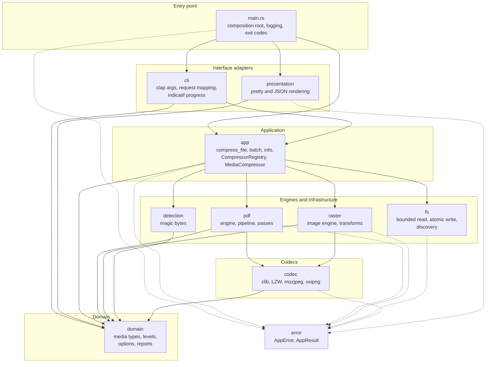
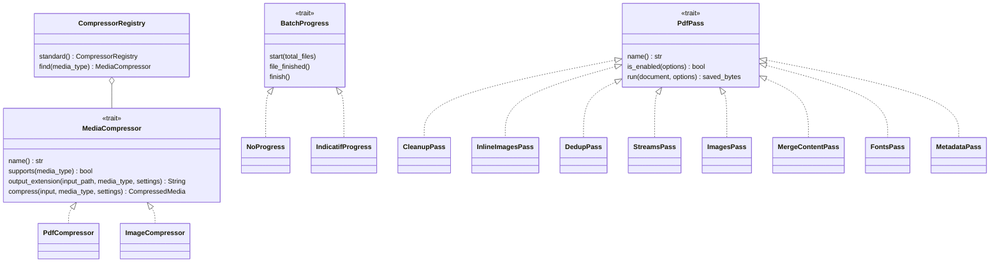
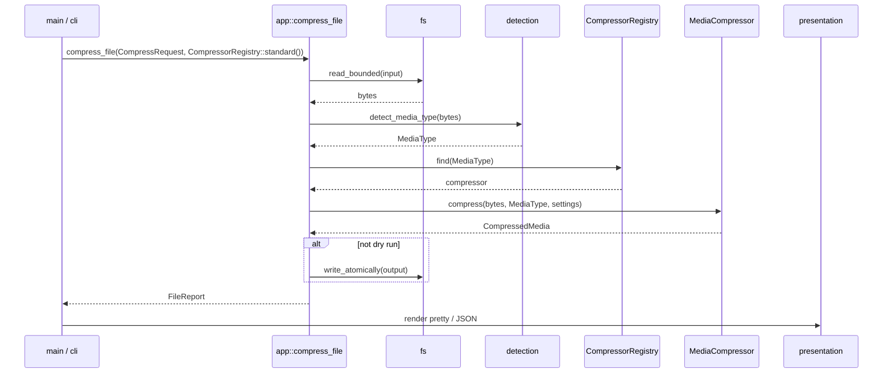

# media-compressor

Fast media compressor written in Rust. Compresses PDF and image files by recompressing images (mozjpeg + oxipng), optimizing streams, deduplicating objects, subsetting fonts, and stripping unnecessary metadata. Auto-detects file type from magic bytes — no extension guessing.

## Features

### PDF Compression
- **4 compression levels** — low, medium, high, extreme with tunable presets
- **Image re-encoding** — mozjpeg (progressive JPEG) and oxipng for embedded images
- **DPI downsampling** — page-aware DPI calculation with configurable targets
- **Smallest encoding wins** — each image is tried as JPEG, PNG-predictor Flate and plain Flate; the smallest result is kept, and only if it beats the original
- **Stream optimization** — zlib recompression, LZW-to-Flate conversion, content stream merging, whitespace compaction
- **Object cleanup** — thumbnails, JavaScript and piece info at every level; markup annotations at high/extreme; output intents at extreme. Link annotations and named destinations are always kept
- **Stream deduplication** — merge streams whose dictionary and bytes are identical and rewrite references
- **Font optimization** — glyph subsetting for identity CID TrueType fonts, driven by a full content stream scan with `/CIDToGIDMap` rebuilt (opt-in)
- **Inline image conversion** — convert BI/ID/EI inline images to XObject references
- **Metadata stripping** — remove /Info dictionary and XMP metadata streams
- **Structure tree removal** — strip /StructTreeRoot, /MarkInfo at high/extreme levels
- **AcroForm removal** — strip interactive form fields and widgets at extreme level, unless the form contains a signature field
- **Embedded file removal** — strip attached files at high/extreme levels
- **Atomic writes** — write to temp file, then rename; clean up on failure

### Image Compression
- **Format detection** — JPEG, PNG, GIF, TIFF, BMP, WebP via magic bytes; only JPEG and PNG can be compressed, other formats are rejected with a clear error
- **Format conversion** — convert between JPEG and PNG
- **Quality control** — configurable encoding quality (1-100)
- **Lossless mode** — JPEG input auto-converted to PNG; PDF images skip lossy re-encoding
- **Alpha preserved** — PNG transparency and bit depth survive; JPEG output flattens onto white with a warning
- **Resize** — max-dimension constraint with aspect ratio preserved (Lanczos3)
- **Grayscale conversion** — single-channel luminance output
- **Progressive JPEG** — enabled by default via mozjpeg
- **PNG optimization** — oxipng with effort levels 2-6 based on compression level
- **EXIF/XMP stripping** — metadata automatically removed during re-encoding

### Batch Processing
- **Parallel compression** — rayon-based with configurable worker count
- **Recursive traversal** — walkdir with glob pattern filtering
- **Mixed media** — PDF and images in the same batch, auto-dispatched
- **Resilient** — continue-on-error mode for large batches
- **Progress indicator** — indicatif progress bars
- **Default pattern** — `*.{pdf,jpg,jpeg,png}` (case-insensitive, symlinks are not followed)

### General
- **Auto-detection** — file type identified from magic bytes, not extension
- **Dry-run** — estimate compression savings without writing output
- **JSON output** — structured reports for scripting and automation
- **Cross-platform** — Linux, macOS, Windows

## Installation

Requires Rust 1.75+ and a C compiler (for mozjpeg).

```bash
# From source
cargo install --path .

# Or build manually
cargo build --release
# Binary at: target/release/media-compressor
```

## Usage

### Compress a single file

```bash
# Auto-detect file type, default (medium) level
media-compressor compress input.pdf
media-compressor compress photo.jpg

# Custom output, level, and quality
media-compressor compress input.pdf -o output.pdf -l high
media-compressor compress input.pdf --image-quality 50 --dpi 120

# Image with format conversion and resize
media-compressor compress photo.png -f jpeg --quality 80 --max-dimension 1920

# Lossless mode (skip lossy re-encoding)
media-compressor compress input.pdf --lossless
media-compressor compress photo.jpg --lossless  # converts JPEG → PNG

# Grayscale conversion
media-compressor compress photo.jpg --grayscale

# High level strips metadata (use --keep-metadata to preserve it)
media-compressor compress input.pdf --level high

# Enable font optimization (PDF only)
media-compressor compress input.pdf --compress-fonts

# Dry run — estimate savings without writing
media-compressor compress input.pdf --dry-run

# JSON output for scripting
media-compressor compress input.pdf --json
```

### Batch compress a directory

```bash
# Compress all supported files in a folder
media-compressor batch ./documents -l medium

# Recursive with custom output directory
media-compressor batch ./documents -r -o ./compressed -l high

# Custom glob pattern and worker count
media-compressor batch ./docs -p "report_*.pdf" -w 4 --continue-on-error

# Batch with font optimization for PDFs
media-compressor batch ./docs -l high --compress-fonts --overwrite

# Batch dry run with JSON output
media-compressor batch ./documents --dry-run --json
```

### Show PDF info

```bash
media-compressor info document.pdf
media-compressor info document.pdf --json
```

## Compression Levels

| Level | Image Quality | DPI Target | PNG Effort | Strip Metadata | Grayscale | Remove Markup Annots / Struct Tree / Embedded Files | Remove AcroForm / Output Intents |
|-------|:---:|:---:|:---:|:---:|:---:|:---:|:---:|
| `low` | 90% | none | 2 | no | no | no | no |
| `medium` (default) | 75% | 200 | 4 | no | no | no | no |
| `high` | 60% | 150 | 5 | yes | no | yes | no |
| `extreme` | 40% | 96 | 6 | yes | yes | yes | yes |

All levels perform: stream recompression, object deduplication, thumbnail/JavaScript/piece info removal, inline image conversion, content stream optimization. Link annotations and named destinations are never removed. AcroForm is kept at every level when it contains a signature field.

## CLI Reference

```
media-compressor [OPTIONS] <COMMAND>

Commands:
  compress    Compress a single file (auto-detects PDF or image)
  batch       Compress all supported files in a directory
  info        Display metadata and size information about a PDF file

Global options:
  -v, --verbose    Enable verbose logging
  -q, --quiet      Suppress all output except errors
```

### `compress` options

| Flag | Description |
|---|---|
| `INPUT` | Input file path (positional, required) |
| `-o, --output <PATH>` | Output file path (default: `<input>_compressed.<ext>`) |
| `-l, --level <LEVEL>` | Compression level: `low`, `medium`, `high`, `extreme` |
| `--keep-metadata` | Preserve document metadata regardless of level |
| `--image-quality <1-100>` | Override JPEG quality for PDF embedded images (takes precedence over `--quality` for PDFs) |
| `--quality <1-100>` | Override encoding quality for image files and PDF embedded images |
| `--dpi <NUM>` | Override target DPI for image downsampling |
| `-f, --format <FMT>` | Output format for images: `original`, `jpeg`, `png` |
| `--max-dimension <PX>` | Resize so no dimension exceeds PX (aspect ratio preserved) |
| `--grayscale` | Convert to grayscale |
| `--lossless` | Lossless mode (skip lossy recompression; JPEG → PNG) |
| `--compress-fonts` | Subset identity CID TrueType fonts (PDF only, opt-in) |
| `--max-input-size <BYTES>` | Reject input files larger than BYTES (default 1 GiB) |
| `--dry-run` | Estimate savings without writing output |
| `--json` | Output report as JSON |
| `--overwrite` | Overwrite existing output file |

### `batch` options

| Flag | Description |
|---|---|
| `INPUT_DIR` | Input directory path (positional, required) |
| `-o, --output-dir <PATH>` | Output directory (default: `<input>_compressed`) |
| `-l, --level <LEVEL>` | Compression level: `low`, `medium`, `high`, `extreme` |
| `-p, --pattern <GLOB>` | Glob pattern (default: `*.{pdf,jpg,jpeg,png}`) |
| `-r, --recursive` | Recurse into subdirectories |
| `-w, --workers <NUM>` | Parallel workers (0 = auto-detect CPU count) |
| `--continue-on-error` | Keep going after a failure (default: stop and skip the remaining files) |
| `--keep-metadata` | Preserve document metadata |
| `--image-quality <1-100>` | Override JPEG quality of PDF images (takes precedence over `--quality` for PDFs) |
| `--quality <1-100>` | Override encoding quality (PDF images and image files) |
| `-f, --format <FMT>` | Output format for images: `original`, `jpeg`, `png` |
| `--max-dimension <PX>` | Resize images so no side exceeds PX |
| `--grayscale` | Convert to grayscale |
| `--lossless` | Lossless mode |
| `--dpi <NUM>` | Override target DPI |
| `--max-input-size <BYTES>` | Reject input files larger than BYTES |
| `--compress-fonts` | Subset identity CID TrueType fonts (PDF only) |
| `--dry-run` | Estimate savings without writing |
| `--json` | Output report as JSON |
| `--overwrite` | Overwrite existing outputs |

### `info` options

| Flag | Description |
|---|---|
| `INPUT` | PDF file path (positional, required) |
| `--json` | Output as JSON |

## Supported File Types

| Format | Detected By | Compress | Batch | Info |
|--------|-------------|:---:|:---:|:---:|
| PDF | `%PDF` header | yes | yes | yes |
| JPEG | `FF D8 FF` magic | yes | yes | - |
| PNG | `89 50 4E 47` magic | yes | yes | - |
| GIF | `GIF87a`/`GIF89a` magic | rejected | rejected | - |
| TIFF | `49 49 2A 00` / `4D 4D 00 2A` magic | rejected | rejected | - |
| BMP | `42 4D` magic | rejected | rejected | - |
| WebP | `RIFF`+`WEBP` magic | rejected | rejected | - |

## Architecture

### Layers

The crate follows a layered clean architecture: dependencies point inward only, and inner layers never import outer ones. `error` is a shared leaf used by every layer.



| Layer | Modules | Rules |
|---|---|---|
| Entry point | `main.rs` | Composition root: builds the registry, picks the progress reporter, renders the report, maps errors to exit codes |
| Interface adapters | `cli`, `presentation` | Only `cli` imports `clap`; only these layers use `colored` / `indicatif` |
| Application | `app` | Orchestrates use cases; never branches on media type |
| Engines and infrastructure | `pdf`, `raster`, `fs`, `detection` | Engines work on in-memory data; only `fs` touches the file system |
| Codecs | `codec` | Single source of truth for zlib, LZW, JPEG and PNG encoding |
| Domain | `domain` | Plain types, no I/O, no external frameworks |

### Extension Points

Three traits decouple the layers, each with real implementations:



### Single-File Flow



### PDF Compression Pipeline

The pipeline is a list of passes run in strict order on an in-memory document (`src/pdf/pipeline.rs`):

1. **Parse** — validate the `%PDF-` header, reject encrypted files, parse with lopdf
2. **Cleanup** — per level: thumbnails, JavaScript and piece info always; markup annotations, struct tree and embedded files at high; forms and output intents at extreme. Named destinations are never removed. Only references are removed, `prune_objects` deletes what becomes unreachable
3. **Inline images** — convert `BI`/`ID`/`EI` to XObjects with the in-house content lexer, so they are compressed by later passes
4. **Stream dedup** — merge streams whose dictionary and bytes are identical
5. **Stream compression** — minify content streams with a tokenizer and re-deflate plain Flate/LZW streams; filter chains and predictors are left alone
6. **Image compression** — DPI downsampling; smallest of JPEG, PNG-predictor Flate and plain Flate wins, and only replaces the image when smaller
7. **Content stream merging** — merge multi-stream pages
8. **Font subsetting** (opt-in) — identity CID TrueType fonts only
9. **Metadata stripping** — remove `/Info`, XMP and `/Metadata` references (level-dependent)
10. **Prune, renumber, serialize** — if the result is not smaller the original bytes are returned

### Image Compression Pipeline

1. **Detect format** — magic bytes, only JPEG and PNG are decodable
2. **Decode** — with image size and allocation limits
3. **Transform** — resize (Lanczos3), grayscale conversion
4. **Encode** — mozjpeg (JPEG) or oxipng (PNG, alpha and bit depth preserved)
5. **Smart replace** — keep the original bytes when a same-format result is not smaller

### Module Layout

```
src/
  main.rs                    # Entry point, exit codes
  lib.rs                     # Module declarations
  error.rs                   # AppError enum (thiserror), exit codes
  domain/                    # Media types, levels, options, reports (no I/O)
  detection/                 # Magic-byte detection (single table)
  codec/                     # zlib, LZW, mozjpeg, oxipng wrappers
  pdf/
    engine.rs                # compress_pdf_bytes: parse, run passes, never-bigger guard
    pipeline.rs              # PdfPass trait and standard pass order
    content_lexer.rs         # Content stream tokenizer (strings, comments, inline images)
    content_minifier.rs      # Tokenizer-based content stream minification
    filters.rs               # Filter chain / predictor aware stream decoding
    font_usage.rs            # Glyph usage collection for font subsetting
    object_graph.rs          # Reference resolution helpers
    passes/                  # cleanup, inline_images, dedup, streams, images,
                             # merge_content, fonts, metadata
  raster/                    # Image engine (bytes in, bytes out), transforms, format resolution
  fs/                        # Bounded reads, atomic writes, symlink-safe discovery
  app/
    media_compressor.rs      # MediaCompressor strategy trait
    registry.rs              # CompressorRegistry (selects strategy by media type)
    pdf_compressor.rs        # PDF strategy
    image_compressor.rs      # Image strategy
    compress_file.rs         # Media-agnostic single-file flow
    batch.rs                 # Parallel batch processing (rayon, scoped pool)
    info.rs                  # PDF info
  presentation/              # Pretty and JSON rendering
  cli/                       # clap args, request mapping, progress bar
  test_support/              # Test-only fixture builders
```

Adding a media type means one new `MediaCompressor` implementation plus one line in `CompressorRegistry::standard()`.

## Development

```bash
make build               # Debug build
make build-release       # Optimized release build (LTO, strip)
make test                # cargo test --all-features
make lint                # clippy -D warnings (zero warnings policy)
make fmt                 # Format code
make check               # test + lint + fmt-check + no-comments (run before committing)
make coverage            # 90% line coverage gate (needs cargo-llvm-cov)
make bench               # criterion benchmarks
```

Shortcuts for running the release binary:

```bash
make run FILE=input.pdf LEVEL=high OUTPUT=out.pdf
make batch DIR=./pdfs LEVEL=high
make dry-run FILE=input.pdf
make info FILE=input.pdf JSON=1
```

### Benchmarks

Uses [criterion](https://docs.rs/criterion) for statistical benchmarking.

```bash
cargo bench                    # Run all benchmarks
# HTML report: target/criterion/report/index.html
```

Benchmarks cover:
- **Compression levels** — low, medium, high, extreme compared side-by-side
- **Stream-only** — low level without resizing to isolate stream compression cost

The benchmark builds its own sample PDF in memory, no input file is needed.

## License

MIT
